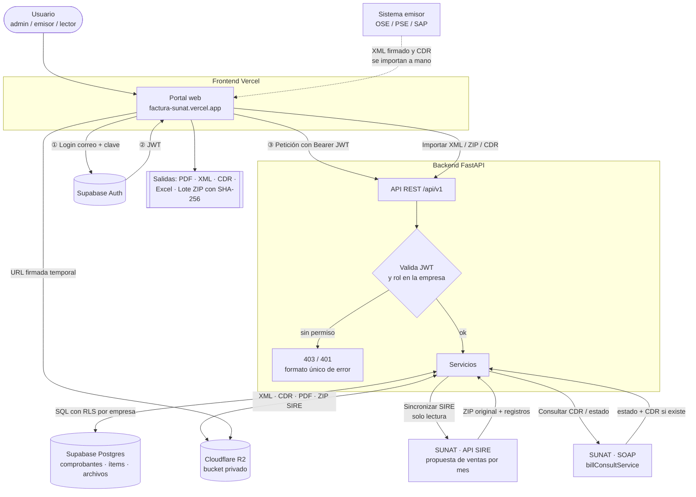
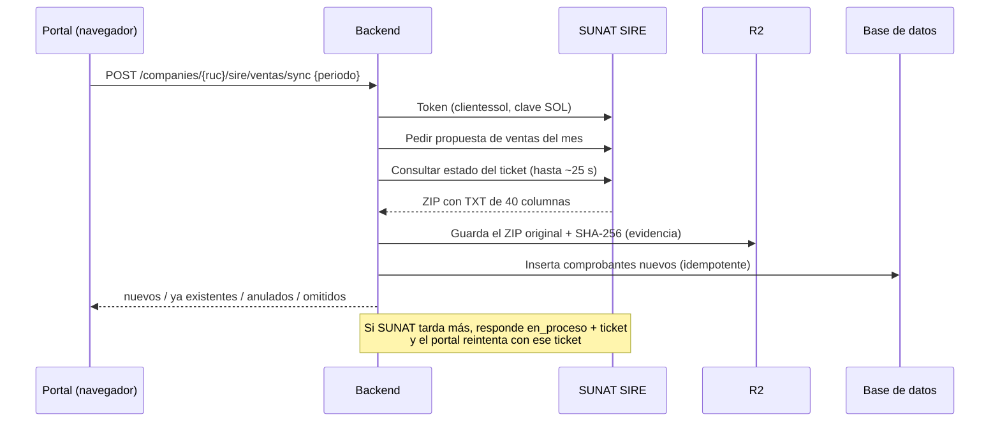

# Portal de Comprobantes SUNAT — Funcionamiento y puesta en marcha

Portal multiempresa para **consultar, respaldar y auditar** los comprobantes
electrónicos de **TDM ASFALTOS S.A.C. (RUC 20514831620)**. Este documento explica cómo
funciona hoy, qué es real y cómo correrlo en una laptop con restricciones.

> Este archivo **no contiene secretos**. Las credenciales (`.env`) se pasan por un
> canal privado (USB, gestor de contraseñas), nunca por GitHub.

---

## 1. Diagrama de funcionamiento



### Flujo de una sincronización SIRE (paso a paso)



---

## 2. Qué hace el portal (y qué no)

| Función | Estado | Origen del dato |
| --- | --- | --- |
| Login y roles por empresa | Real | Supabase Auth + RLS |
| Listado, filtros, KPIs | Real | Supabase (247 comprobantes de SIRE, 2026-09) |
| Sincronizar ventas por mes | Real, solo lectura | SUNAT SIRE |
| Importar XML / ZIP | Real | Se archivan en R2; completan registros SIRE |
| Importar CDR (ZIP `R-RUC-tipo-serie-número`) | Real | Se archivan en R2 y actualizan el estado |
| Consultar CDR en SUNAT | Real | SOAP; devuelve `0013` si otro sistema emitió la factura |
| PDF | Copia informativa | Lo genera el backend con los datos; **no** es evidencia ante SUNAT |
| Indicadores XML / CDR / PDF por fila | Real | Tabla `archivos` |
| Lote ZIP de auditoría | Real | XML y CDR originales + `LEEME` + `manifiesto.csv` (SHA-256) |
| Check SAP / N° SAP | Real | Se guarda en la base |
| **Emisión y firma de XML** | **Aún no** | Diferido a otra fase |

Lo que se eliminó a propósito: XML fabricados en el navegador, envío de correos a
direcciones inventadas, ficha SUNAT con datos fijos y el botón "Emitir" simulado.

**Hallazgo clave:** SIRE no entrega XML ni ítems. El XML firmado y el CDR deben venir del
sistema que emite a SUNAT (OSE/PSE/SAP) y se cargan con **Importar**.

---

## 3. Correrlo desde la laptop de la empresa (restringida)

Piezas del sistema y dónde viven:

| Pieza | Dónde corre | Puerto / protocolo |
| --- | --- | --- |
| Frontend | Vercel (ya publicado) o local | HTTPS 443 / `3000` local |
| Backend FastAPI | PC de casa (Docker + túnel) o local | `8000` local |
| Base de datos y Auth | Supabase (nube) | HTTPS 443; Postgres 5432/6543 |
| Archivos | Cloudflare R2 (nube) | HTTPS 443 |

### Opción A (recomendada, **cero instalación**): solo el navegador

La laptop solo abre `https://factura-sunat.vercel.app`. El backend sigue corriendo en tu
**PC de casa** (Docker + túnel) y Vercel apunta a él. No instalas nada en la laptop de la
empresa y no necesita llegar a Postgres.

**En la PC de casa, la víspera y el día de la presentación:**

1. Docker Desktop abierto y **suspensión desactivada** (Configuración → Sistema →
   Inicio/apagado y batería → Pantalla y suspensión: "Nunca" mientras esté enchufada).
2. Desde la carpeta del backend:
   ```powershell
   .\demo-start.ps1
   ```
   Imprime la URL pública (`https://….trycloudflare.com`).
3. Si esa URL **cambió** respecto a la que tiene Vercel, actualiza
   `NEXT_PUBLIC_API_URL` en Vercel (Settings → Environment Variables) y haz
   *Redeploy*. Para no depender de eso, usa una URL fija:
   ```powershell
   .\demo-start.ps1 -Ngrok -Dominio "tu-dominio.ngrok-free.app" -Token "TU_TOKEN_NGROK"
   ```
   (dominio estático gratuito en ngrok.com → Domains). Así la URL no cambia nunca.
4. Comprueba desde el celular (datos móviles) que `https://TU-URL/health` responde.

**En la laptop:** abre el navegador, entra al portal y usa tu usuario. Si la red de la
empresa bloquea `trycloudflare.com`, prueba con el celular como punto de acceso
(*hotspot*) o con ngrok (otro dominio).

### Opción B: todo local en la laptop (sin Docker, sin administrador)

Solo si la empresa permite descargar y ejecutar programas **sin privilegios de
administrador** y la red deja salir a Supabase por el puerto 5432/6543 (se prueba abajo).

**IPs y puertos a usar (los menos propensos a estar bloqueados):**

| Uso | Dirección | Por qué |
| --- | --- | --- |
| Backend | `http://127.0.0.1:8000` | Loopback: nunca sale a la red, el firewall no lo toca. Los puertos > 1024 no piden administrador. |
| Frontend | `http://localhost:3000` | Igual. |
| Si el puerto está ocupado | `8001` / `3001` | Cámbialo también en `CORS_ORIGINS` y `NEXT_PUBLIC_API_URL`. |

No uses la IP de la red de la empresa (`192.168.x.x` / `10.x.x.x`) ni `0.0.0.0`: el
firewall corporativo suele bloquear el tráfico entrante y no hace falta, porque
navegador, frontend y backend están en la misma máquina.

#### B.1 Probar la red antes de instalar nada (PowerShell)

```powershell
# Reemplaza HOST por el host de tu DATABASE_URL (…pooler.supabase.com)
Test-NetConnection HOST -Port 5432
Test-NetConnection HOST -Port 6543
Test-NetConnection ehdbmnozhbbqiicoirjq.supabase.co -Port 443
Test-NetConnection api-seguridad.sunat.gob.pe -Port 443
```
Si Postgres (5432 **y** 6543) da `TcpTestSucceeded : False`, la Opción B no funcionará en
esa red: usa la Opción A.

#### B.2 Instalar sin administrador

Todo va a tu carpeta de usuario (`%USERPROFILE%\portal`):

1. **uv** (gestiona Python 3.12 en tu usuario, sin admin):
   ```powershell
   powershell -ExecutionPolicy ByPass -c "irm https://astral.sh/uv/install.ps1 | iex"
   ```
   Si bloquean scripts, descarga `uv-x86_64-pc-windows-msvc.zip` desde
   `github.com/astral-sh/uv/releases`, descomprime `uv.exe` y úsalo con su ruta completa.
2. **Node 20+ portable**: descarga el `.zip` de `nodejs.org/dist` (no el instalador),
   descomprímelo y agrégalo al PATH **solo de la sesión**:
   ```powershell
   $env:Path = "$env:USERPROFILE\portal\node;$env:Path"
   corepack enable   # o: npm i -g pnpm@11.5.0 --prefix $env:USERPROFILE\portal\node
   ```
3. **Git** (opcional): si no hay, descarga los dos repos como ZIP desde GitHub
   (*Code → Download ZIP*).

#### B.3 Backend (puerto 8000)

```powershell
cd $env:USERPROFILE\portal\portal-sunat-back
uv sync                      # instala Python 3.12 y dependencias
copy .env.example .env       # luego pega los valores reales (ver abajo)
uv run fastapi run --host 127.0.0.1 --port 8000
```
Comprobación: abre `http://127.0.0.1:8000/health`; debe responder un JSON de estado.

Variables mínimas en `.env` (los valores reales los recibes por canal privado):

```
ENVIRONMENT=dev
SUNAT_ENV=prod
CONFIRM_PROD_EMISSION=false          # NO cambiar: la emisión está bloqueada
DATABASE_URL=…                       # pooler de Supabase
SUPABASE_URL=https://ehdbmnozhbbqiicoirjq.supabase.co
SUPABASE_JWT_ALG=…  SUPABASE_JWT_SECRET=…   (o SUPABASE_JWT_JWKS_URL)
R2_ACCOUNT_ID=…  R2_ACCESS_KEY_ID=…  R2_SECRET_ACCESS_KEY=…  R2_BUCKET_NAME=…  R2_ENDPOINT_URL=…
SUNAT_CRED_20514831620_SOL_USER=…  _SOL_PASSWORD=…  _CLIENT_ID=…  _CLIENT_SECRET=…
CORS_ORIGINS=http://localhost:3000,http://127.0.0.1:3000
```
`localhost` y `127.0.0.1` son orígenes **distintos** para CORS: pon los dos.

#### B.4 Frontend (puerto 3000)

```powershell
cd $env:USERPROFILE\portal\factura-sunat
pnpm install
```
Crea `.env.local`:
```
NEXT_PUBLIC_API_URL=http://127.0.0.1:8000
NEXT_PUBLIC_SUPABASE_URL=https://ehdbmnozhbbqiicoirjq.supabase.co
NEXT_PUBLIC_SUPABASE_ANON_KEY=<clave anon pública, completa, sin comillas>
```
```powershell
pnpm dev        # http://localhost:3000
```

#### B.5 Qué queda sincronizado

Local y nube comparten **la misma base (Supabase) y el mismo bucket (R2)**: todo lo que
importes o sincronices en la laptop aparece en el portal de Vercel y viceversa. No hay
copia local de datos.

---

## 4. Seguridad (importante)

- **Rota** las credenciales que estuvieron en `env.txt` del repo público (base, JWT
  secret, llaves R2, clave SOL, client secret) y pon el repo en **privado**. Después de
  rotar, actualiza el `.env` de casa y el de la laptop.
- Cuenta de prueba `123@gmail.com` (clave `123456`, rol `emisor`): **elimínala** tras la
  presentación.
- En la laptop de la empresa no dejes el `.env`; bórralo al terminar. Nunca subas `.env`,
  `env.txt` ni `.pfx` a GitHub, ni pegues claves en chats o correos.

## 5. Guion sugerido para la presentación del viernes

1. Login con rol; mostrar KPIs (facturado neto en soles/dólares, anulados excluidos).
2. Tabla: filtros, indicadores XML / CDR / PDF por fila, cobertura de respaldo.
3. Detalle de un comprobante: Resumen / Ítems / Archivos / Vista PDF.
4. **Sincronizar SIRE** de un mes → "ya existían" (idempotente) y la evidencia con su hash.
5. Importar un XML real y su CDR → el indicador pasa a verde.
6. Lote ZIP de auditoría con `manifiesto.csv` y exportar a Excel.
7. Cerrar con lo pendiente: emisión y firma (fase siguiente) y desplegar el backend en
   un servidor fijo.

## 6. Problemas frecuentes

| Síntoma | Causa probable | Solución |
| --- | --- | --- |
| Portal carga pero sin datos | La PC de casa o el túnel están apagados, o la URL cambió | Reiniciar `demo-start.ps1` y actualizar `NEXT_PUBLIC_API_URL` en Vercel |
| Error CORS en consola | `CORS_ORIGINS` no incluye el origen exacto | Agregar `http://localhost:3000` y `http://127.0.0.1:3000` |
| 401 al entrar | Anon key mal copiada o reloj desfasado | Copiar la clave completa; sincronizar la hora de Windows |
| Falla la descarga de XML/CDR | CORS del bucket R2 | Permitir GET/HEAD para el dominio del frontend |
| `0013` al consultar CDR | La factura la emitió otro sistema | Importar el CDR desde el sistema emisor |
| Sin conexión a la base (Opción B) | Puertos 5432/6543 bloqueados | Usar la Opción A |
